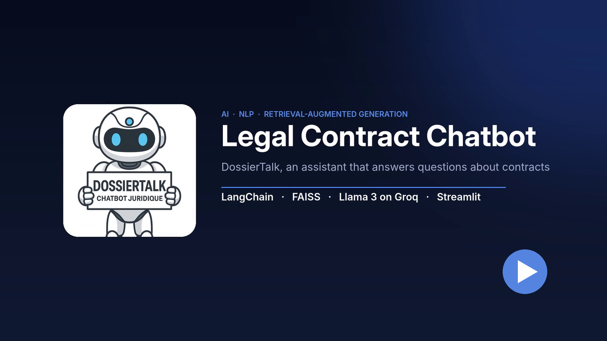
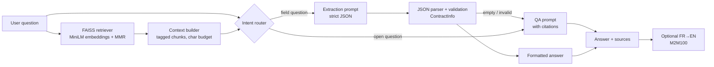

# Legal Contract Chatbot

[](https://github.com/houdamardas1/legal-chatbot/actions/workflows/ci.yml)


An AI assistant that answers questions about legal contracts. It retrieves the relevant clauses with **semantic search (FAISS)**, grounds a **Llama 3 model served by Groq** on them, and cites its sources. For factual questions ("who signed?", "what is the amount?") it switches to a **structured extraction** mode that returns validated fields instead of free text.

Built as my end-of-studies internship project (PFE), then refactored into a tested, packaged application.

## Demo

[](docs/demo-short.mp4)

A 40-second walkthrough of the Streamlit app: indexing a contract corpus, asking questions in plain language, source-cited answers, field extraction, bilingual output and contract summarisation. [Watch the video](docs/demo-short.mp4).

## Features

- **Grounded question answering**: answers are generated only from retrieved contract excerpts, with `[doc_id]` citations and a source panel in the UI.
- **Structured field extraction**: client, contract type, contract date, signatories (name, title, signature date) and amount are extracted as strict JSON, validated, cleaned of template placeholders (`_____`, `[Name]`, `insert legal name`…) and normalised (ISO dates).
- **Intent routing**: an accent-insensitive French/English router decides between extraction and open QA, and falls back to QA when extraction finds nothing.
- **Better retrieval**: chunks sized for the embedding model's context window, normalised embeddings with inner-product search, and MMR re-ranking for diverse results.
- **Resilient LLM client**: a custom LangChain `LLM` for Groq with timeouts, exponential backoff on `429/5xx` and network errors, no retries on client errors, and an API key kept in a `SecretStr`.
- **Bring your own corpus**: upload a JSON file in the UI to index it on the fly (cached by content hash).
- **Bilingual output**: optional French → English translation with Meta's M2M100.
- **Two interfaces**: a Streamlit chat app and a `legal-chatbot` CLI.

## Architecture



| Module | Responsibility |
|---|---|
| [`config.py`](src/legal_chatbot/config.py) | Typed settings, every value overridable by an environment variable |
| [`llm.py`](src/legal_chatbot/llm.py) | Groq API client as a LangChain `LLM`, with retries and error types |
| [`rag.py`](src/legal_chatbot/rag.py) | Corpus loading and validation, chunking, FAISS index, retrieval, `ContractAssistant` |
| [`extraction.py`](src/legal_chatbot/extraction.py) | Intent detection, JSON parsing, placeholder filtering, date normalisation, formatting |
| [`prompts.py`](src/legal_chatbot/prompts.py) | All prompt templates in one reviewable place |
| [`app.py`](src/legal_chatbot/app.py) / [`cli.py`](src/legal_chatbot/cli.py) | Streamlit UI and command-line entry points |

Heavy dependencies (PyTorch, FAISS, Transformers) are imported lazily, so the core logic installs in seconds and is fully unit-testable without downloading any model.

## Tech stack

Python · LangChain · FAISS · Hugging Face (sentence-transformers, Transformers) · Groq (Llama 3) · Streamlit · Pydantic · pytest · Ruff · GitHub Actions · Docker

## Getting started

### 1. Install

```bash
git clone https://github.com/houdamardas1/legal-chatbot.git
cd legal-chatbot
python -m venv .venv && source .venv/bin/activate   # Windows: .venv\Scripts\activate
pip install -e ".[app]"
```

### 2. Configure

```bash
cp .env.example .env
```

Set `GROQ_API_KEY` in `.env` (free key at [console.groq.com](https://console.groq.com/keys)). All other settings have sensible defaults; see [`.env.example`](.env.example).

### 3. Build the index

A small sample corpus of three fictional contracts is included, so this works out of the box:

```bash
legal-chatbot build-index                       # uses data/sample_contracts.json
legal-chatbot build-index --corpus path/to/cuad.json
```

For a realistic corpus, use the [CUAD dataset](https://www.atticusprojectai.org/cuad) (510 commercial contracts) converted to:

```json
{ "documents": [ { "id": 1, "title": "optional", "text": "This Agreement is entered into by ..." } ] }
```

### 4. Chat

```bash
streamlit run app.py        # web UI on http://localhost:8501
legal-chatbot chat          # terminal
```

### Docker

```bash
docker build -t legal-chatbot .
docker run --env-file .env -p 8501:8501 legal-chatbot
```

## Example questions

| Question | Mode |
|---|---|
| *Quel est le nom du client ?* | extraction |
| *Qui sont les signataires et quand ont-ils signé ?* | extraction |
| *Quel est le montant du contrat ?* | extraction |
| *Que prévoit la clause de confidentialité ?* | open QA |
| *Comment résilier le contrat ?* | open QA |

## Tests and quality

```bash
pip install -e ".[dev]" langchain-community faiss-cpu streamlit
pytest --cov=legal_chatbot
ruff check . && ruff format --check .
```

The suite (78 tests) covers intent routing, JSON parsing of messy LLM output, placeholder filtering, date normalisation, the retry policy of the Groq client (mocked HTTP), corpus validation, the extraction → QA fallback logic (fake LLM and retriever), a FAISS build/save/load round trip with deterministic fake embeddings, and headless Streamlit smoke tests. CI runs lint and tests on Python 3.10, 3.11 and 3.12 for every push.

## Roadmap

- Evaluation harness on CUAD's annotated clauses (retrieval recall@k, extraction F1).
- Hybrid retrieval (BM25 + dense) and a cross-encoder re-ranker.
- PDF ingestion with page-level citations.
- Streaming responses in the UI.

## Security

No credentials are stored in this repository. The API key is read from the environment (or a git-ignored `.env`) and never logged. FAISS indexes are loaded with pickle, so only load indexes you built yourself.

## Author

**Houda Mardas** · [GitHub](https://github.com/houdamardas1)
